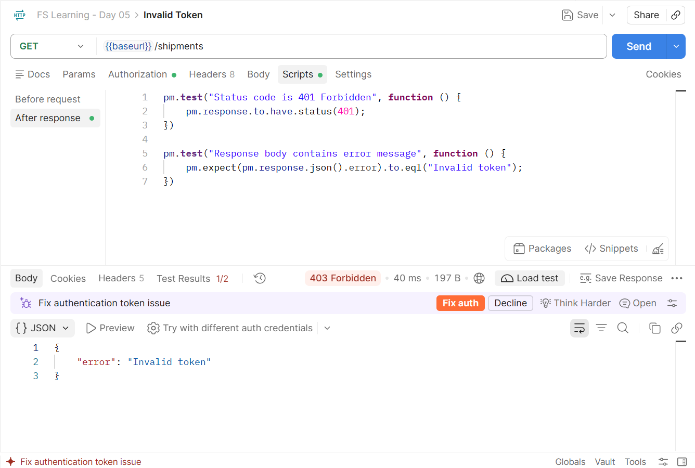

## BUG-006 — Request with an invalid authentication token returns 403 instead of 401

**Environment:**
- Sandbox version: v3.4.0
- Testing tool: Postman
- User/role: Unauthenticated client using an invalid token

**Preconditions:**
- Sandbox is running.
- An invalid authentication token is used.
- No valid authentication credentials are supplied with the request.

**Steps to Reproduce:**
1. Restart the sandbox.
2. Open the GET Shipments request in Postman.
3. Configure Bearer Token authentication.
4. Enter an invalid token.
5. Send the GET request.
6. Observe the response status and body.

**Request:**
```http
GET http://localhost:4010/shipments
Authorization: Bearer invalid-token
```

**Expected:** `401 Unauthorized`; the request is rejected and no shipment data is disclosed.

**README rule:** Invalid or expired authentication tokens must return `401 Unauthorized`.

**Actual:** `403 Forbidden` is returned instead of the expected `401 Unauthorized`.

**Severity:** Low

**Severity Justification:** The API returns an incorrect authentication error code, but the request is still rejected. No unauthorized data access has been demonstrated.

**Priority:** Medium (proposed) — Should be addressed to maintain consistent authentication behavior and allow API consumers to distinguish invalid credentials from insufficient permissions.

**Evidence:**


**Impact:** API consumers receive an incorrect authentication error code, preventing them from correctly distinguishing authentication failures from authorization failures.