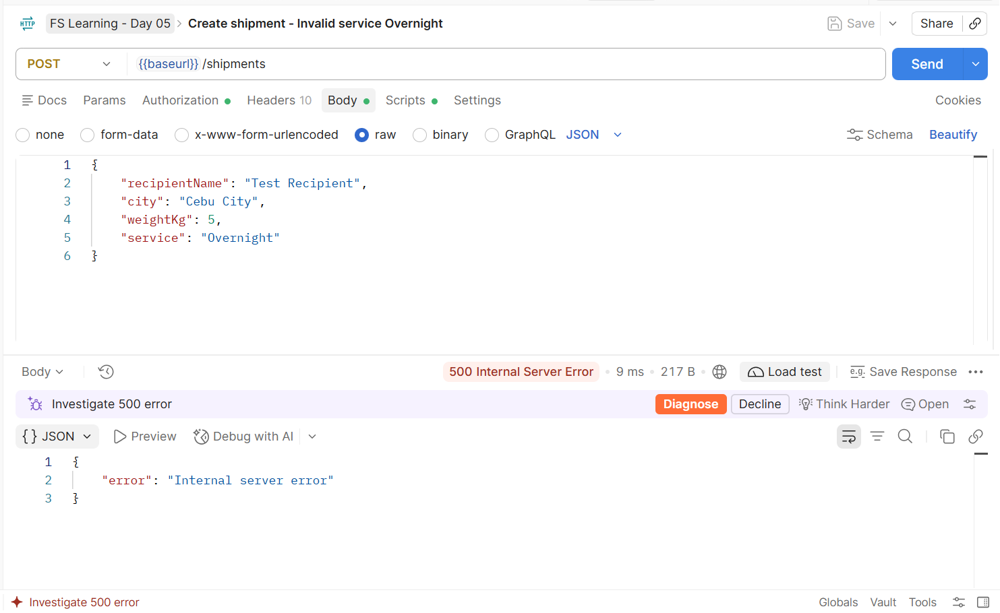

## BUG-008 — Creating a shipment with an invalid service returns 500 instead of 400

**Environment:**
- Sandbox version: v3.4.0
- Testing tool: Postman
- Username: ana (proposed retest account)
- Role: merchant_admin
- Merchant ID: 1

**Preconditions:**
- Merchant admin is authenticated with a valid token.
- Shipment creation endpoint is accessible.
- Existing shipment ID: Not applicable.
- Shipment starting status: Not applicable.

**Steps to Reproduce:**
1. Restart the sandbox to restore the original test data.
2. Log in as ana, a merchant admin of Merchant 1.
3. Send `GET http://localhost:4010/shipments` and record the existing shipments.
4. Send the POST request below using the merchant admin token.
5. Provide valid recipient name, city, and weight values.
6. Set the service value to Overnight.
7. Observe the response status and body.
8. Retrieve the shipment list again to verify whether an invalid shipment was created.

**Request:**
```http
POST http://localhost:4010/shipments
```

```json
{
    "recipientName": "Test Recipient",
    "city": "Cebu City",
    "weightKg": 5,
    "service": "Overnight"
}
```

**Expected:** `400 Bad Request`; the unsupported service value is rejected, and no shipment is created.

**README rule:** Only Standard, Express, and SameDay are supported service values. Any unsupported service value must return `400 Bad Request`.

**Actual:** `500 Internal Server Error` is returned when attempting to create a shipment with an unsupported service value (Overnight) instead of the expected `400 Bad Request`.

**Response Body:**
[Insert actual POST response body.]

**Shipment Creation Result:** [Verify whether a new shipment was created.]

**Severity:** Medium

**Severity Justification:** The defect affects input validation and API error handling in the shipment creation endpoint, but no persisted data corruption or complete loss of functionality has been demonstrated.

**Priority:** High (proposed) — Should be addressed before release because unsupported service values trigger server errors in a core shipment creation endpoint, affecting API reliability.

**Evidence:**


**Impact:** An unsupported service value triggered an internal server error instead of a client validation error, preventing API consumers from receiving the documented validation response.